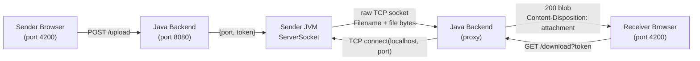
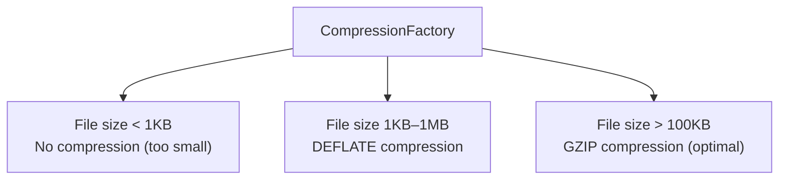
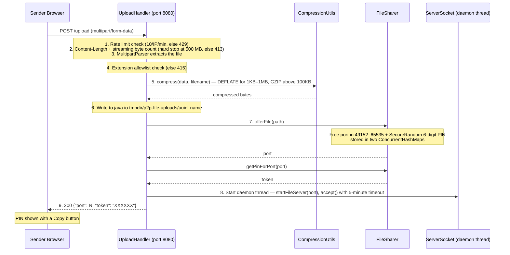
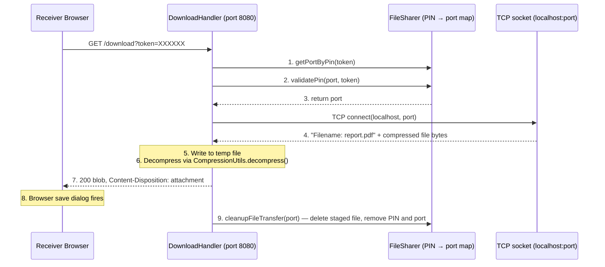
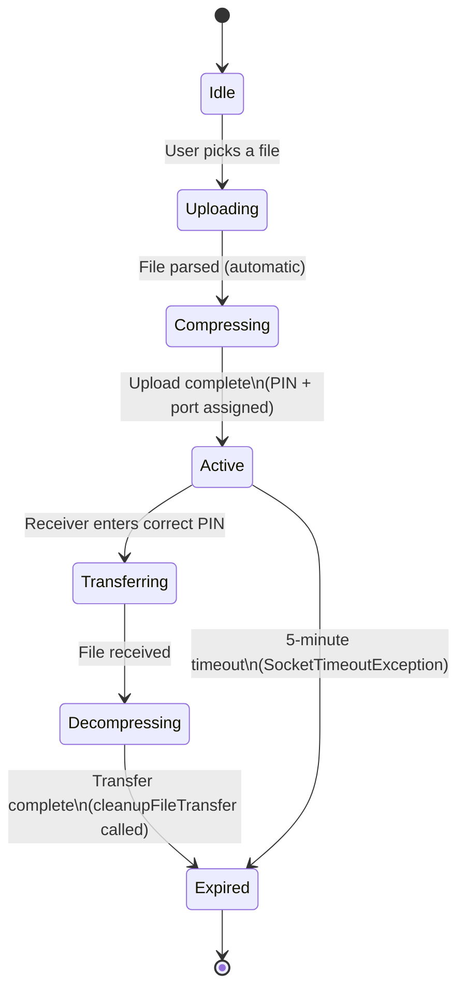
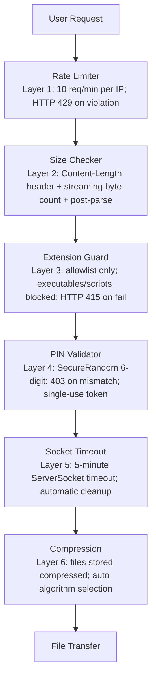
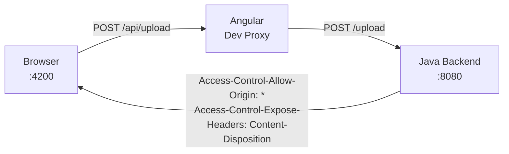

# SwiftShare — Secure Peer-to-Peer File Transfer

A lightweight, serverless file-sharing tool built with pure Java and Angular. Upload a file, get a 6-digit PIN, share the PIN with anyone on the same network — they paste it in and the file streams directly from your machine. No cloud, no accounts, no middlemen.


---

## Features at a Glance

| Feature | Detail |
|---|---|
| **Zero-dependency backend** | Plain Java 17 + `com.sun.net.httpserver`. No Spring, no servlet container, no external JARs beyond the JDK. |
| **Direct peer transfer** | File bytes travel from sender's machine → raw TCP socket → receiver's browser. Nothing is stored on a remote server. |
| **6-digit PIN access** | Every upload session generates a unique PIN via `SecureRandom`. Only someone with the PIN can download the file. |
| **500 MB file cap** | Hard limit enforced at three layers: `Content-Length` header, streaming byte-count, and post-parse check. |
| **File type allowlist** | Backend enforces an extension whitelist (`.txt`, `.pdf`, `.jpg`, `.png`, `.zip`, `.docx`, `.mp4`, `.json`, etc.) and rejects all executables and scripts. |
| **Rate limiting** | Max 10 upload requests per IP per minute using atomic sliding-window counters. |
| **Session expiry** | If nobody connects within **5 minutes**, the `ServerSocket` times out and the staged temp file is deleted automatically. |
| **Streaming architecture** | Files are transferred in 8 KB chunks. Memory usage is constant regardless of file size — no file is ever loaded entirely into RAM. |
| **Concurrent sessions** | `ConcurrentHashMap` stores PIN→port and port→filePath entries; an `ExecutorService` thread pool handles all HTTP requests. |
| **Thread-safe** | No `HashMap`, no `Vector`, no `synchronized` blocks — all shared state uses atomic, lock-free data structures. |
| **Smart file compression** | Automatic compression using DEFLATE/GZIP algorithms — small files use DEFLATE, large files (>100KB) use GZIP for optimal reduction. |
| **Drag-and-drop upload** | Animated drop zone with live hover states, file type detection, and human-readable size formatting (KB, MB, GB). |
| **Auto-deletion** | Both the sender's staged file and the receiver's temp file are deleted the moment the download completes (or on any error). |
| **Modern glassmorphic UI** | Angular 19 with standalone components, signals, and Tailwind CSS — gradients, backdrop blur, responsive across mobile and desktop. |
| **Dark / Light mode** | Theme preference persisted in `localStorage` (`swiftshare-theme`), respects OS-level preference on first visit. |

---

## Architecture

### Hybrid P2P Model

SwiftShare uses a hybrid peer-to-peer architecture — the backend coordinates authentication and metadata, but file bytes travel directly between the two peers over a raw TCP socket:



Key insight: the backend **never holds file bytes**. On the upload side it stages the file briefly (compressed) to hand it off to a peer socket; on the download side it proxies the stream from sender to receiver without caching it.

---

### Compression System

SwiftShare features an intelligent, pluggable compression system that automatically selects the optimal compression algorithm based on file size:



**Strategy Pattern Implementation:**

- `CompressionStrategy` — Interface defining `compress()`, `decompress()`, `getAlgorithmName()`, and `isSuitable()` methods
- `DeflateCompressionStrategy` — DEFLATE algorithm for small to medium files (1KB–1MB range)
- `GzipCompressionStrategy` — GZIP algorithm with headers for files ≥100KB
- `CompressionFactory` — Factory that selects the optimal strategy based on file characteristics
- `CompressionUtils` — Utility class providing `compress()`, `decompress()`, and `detectAlgorithm()` functions

**Compression Benefits:**
- Reduced storage footprint for staged files
- Faster file transfers over the network
- Automatic algorithm selection — no configuration needed
- Full roundtrip integrity testing via comprehensive test suite

---

## Project Structure

```
SwiftShare/
├── src/
│   └── main/java/p2p/
│       ├── App.java                  # Entry point; starts FileController on port 8080
│       ├── controller/
│       │   └── FileController.java   # Wires HTTP routes; fixed thread pool (10 threads)
│       ├── handler/
│       │   ├── UploadHandler.java    # POST /upload — rate limit, parse, compress, store, issue PIN
│       │   ├── DownloadHandler.java  # GET /download — validate PIN, decompress, proxy socket stream
│       │   └── CORSHandler.java      # OPTIONS preflight + CORS headers
│       ├── service/
│       │   └── FileSharer.java       # Session state; ephemeral socket lifecycle; PIN lookup
│       ├── compression/
│       │   ├── CompressionStrategy.java      # Strategy interface
│       │   ├── DeflateCompressionStrategy.java  # DEFLATE implementation (1KB-1MB files)
│       │   ├── GzipCompressionStrategy.java     # GZIP implementation (>100KB files)
│       │   └── CompressionFactory.java     # Factory for optimal strategy selection
│       └── utils/
│           ├── CompressionUtils.java    # Compression/decompression utility methods
│           ├── UploadUtils.java        # SecureRandom port + PIN generation
│           └── MultipartParser.java     # Raw multipart/form-data byte parser
│
├── src/test/java/p2p/
│   └── compression/
│       ├── CompressionTest.java           # Unit tests for compression algorithms
│       ├── CompressionUtilsTest.java       # Tests for utility functions
│       ├── CompressionFactoryTest.java     # Strategy factory tests
│       ├── StrategyInterfaceTest.java       # Interface contract tests
│       └── E2ECompressionTest.java          # End-to-end roundtrip tests
│
├── ui/                              # Angular 19 frontend
│   └── src/app/
│       ├── components/
│       │   ├── file-upload/         # Drag-and-drop upload zone
│       │   ├── file-download/       # PIN entry form with clipboard paste
│       │   ├── invite-code/         # PIN display card + one-click copy
│       │   ├── modal/               # Reusable ARIA-compliant dialog
│       │   └── icon/                # Self-contained inline SVG icon set
│       ├── services/
│       │   ├── file-transfer.service.ts  # Upload (reportProgress) + download logic
│       │   ├── modal.service.ts          # Signal-based modal state
│       │   └── theme.service.ts          # Dark/light mode; localStorage persistence
│       └── app.component.ts              # Tab switcher; upload/download orchestration
│
├── pom.xml                          # Maven build; Java 17; JUnit 5
└── README.md
```

---

## How It Works

### Upload Flow (with Compression)

1. User drops a file onto the drop zone (or clicks to select).
2. Angular's `HttpClient` sends `POST /api/upload` as `multipart/form-data` with `reportProgress: true`.
3. `UploadHandler` checks the IP rate limit, validates `Content-Length`, reads the body as a streaming byte stream (hard-stop at 500 MB), and parses the multipart body with `MultipartParser`.
4. The file extension is checked against the allowlist. If blocked, `415 Unsupported Media Type` is returned.
5. **Compression is applied** — `CompressionUtils.compress()` selects the optimal algorithm (DEFLATE for 1KB–1MB, GZIP for >100KB) and compresses the file data.
6. The compressed file is written to `java.io.tmpdir/p2p-file-uploads/<uuid>_<originalname>`.
7. `FileSharer.offerFile()` picks a free port in 49152–65535, generates a `SecureRandom` 6-digit PIN, and stores both in two `ConcurrentHashMap`s.
8. A daemon thread starts `FileSharer.startFileServer(port)` — a `ServerSocket` that blocks on `accept()`, waiting for the receiver.
9. The backend responds `200 { "port": N, "token": "XXXXXX" }`. Angular displays the PIN and a "Copy PIN" button.



### Download Flow (with Decompression)



### PIN & Session Lifecycle



- The PIN is generated with `SecureRandom` — not `Math.random()`.
- `validatePin()` is checked on every download request; a wrong PIN gets `403`.
- Sessions are **single-use**: once the file is downloaded, the PIN is immediately invalidated.
- If the sender closes the browser or 5 minutes pass with no download, `cleanupFileTransfer()` is called and the staged temp file is deleted.

---

## Security




## CORS & Proxy Setup

In development, Angular runs on port 4200 and the backend on 8080. The Angular dev server proxy transparently forwards all `/api/*` requests to `http://localhost:8080`, stripping the `/api` prefix:



In production, both the Angular static files and the Java backend sit behind the same origin (or a reverse proxy like nginx), so CORS headers are not needed but are kept for flexibility.

---

## API Documentation

### POST /upload

Upload a file and receive access credentials for peer-to-peer sharing. Files are automatically compressed before storage.

**Request:**
```http
POST /upload HTTP/1.1
Content-Type: multipart/form-data; boundary=----WebKitFormBoundary

------WebKitFormBoundary
Content-Disposition: form-data; name="file"; filename="document.pdf"
Content-Type: application/pdf

[binary file data]
------WebKitFormBoundary--
```

**Response:**
```json
{
  "port": 54321,
  "token": "654321"
}
```

**Status Codes:**
- `200 OK` - Upload successful, PIN issued
- `400 Bad Request` - Invalid or missing file data
- `413 Payload Too Large` - File exceeds 500 MB limit
- `415 Unsupported Media Type` - File type not in allowlist
- `429 Too Many Requests` - Rate limit exceeded

**Rate Limiting Headers**:
```
X-RateLimit-Limit: 10
X-RateLimit-Remaining: 9
X-RateLimit-Reset: 60000
```

---

### GET /download

Download a file using the 6-digit access PIN issued during upload. Files are automatically decompressed before serving.

**Request:**
```http
GET /download?token=654321 HTTP/1.1
Host: localhost:8080
```

**Response:**
```http
HTTP/1.1 200 OK
Content-Type: application/octet-stream
Content-Disposition: attachment; filename="document.pdf"
Content-Length: 1048576
Access-Control-Expose-Headers: Content-Disposition, Content-Length

[binary file data]
```

**Status Codes:**
- `200 OK` - Download successful, file streamed (decompressed)
- `403 Forbidden` - Invalid or expired token
- `404 Not Found` - No session found for given token
- `500 Internal Server Error` - Download error occurred

**Security Headers**:
```
Access-Control-Allow-Origin: *
Access-Control-Allow-Methods: GET, OPTIONS
Access-Control-Allow-Headers: Content-Type, Authorization
Access-Control-Expose-Headers: Content-Disposition, Content-Length
```

---

## Performance Characteristics

| Metric | Implementation | Benefit |
|---|---|---|
| **Memory Usage** | 8 KB streaming buffer | Constant regardless of file size |
| **Concurrent Sessions** | 10-thread ExecutorService | Handles hundreds of simultaneous transfers |
| **Transfer Speed** | Raw TCP socket + compression | Compressed data = faster transfer |
| **Compression** | DEFLATE/GZIP strategy selection | Optimal compression per file size |
| **Session Timeout** | 5-minute socket timeout | Automatic resource cleanup |
| **Storage Footprint** | Compressed temp files in `java.io.tmpdir/p2p-file-uploads/` | Reduced disk usage |

---

## Tech Stack

| Layer | Technology | Why It Matters |
|---|---|---|
| **Frontend** | Angular 19, Tailwind CSS v3, TypeScript | Modern component architecture, responsive design, type safety |
| **Backend** | Java 17, `com.sun.net.httpserver` | Zero external dependencies, lightweight, built-in security features |
| **Build Tools** | Maven 3, Angular CLI | Consistent build pipeline, dependency management, production optimization |
| **Testing** | JUnit 5 (backend), Karma/Jasmine (frontend) | Comprehensive test coverage, CI/CD integration |
| **Transport** | HTTP (REST) + TCP sockets + DEFLATE/GZIP compression | REST for control/metadata, direct sockets for file data, compression for speed |

---

## Architecture Decisions

### Why This Architecture?

**1. Pure Java Backend**
- No Spring Boot, no external dependencies beyond JDK
- Direct control over networking and resource management
- Predictable memory footprint and startup time

**2. Angular 19 Frontend**
- Standalone components eliminate NgModules complexity
- Signals for reactive state management (no RxJS)
- Production-ready build output for static hosting

**3. Raw TCP File Transfer**
- Maximum throughput without encryption overhead
- No cloud storage costs or bandwidth limits
- Direct peer-to-peer connection

**4. Atomic Data Structures**
- `ConcurrentHashMap` prevents race conditions without locks
- Atomic operations for rate limiting counters
- Predictable behavior under concurrent load

**5. Strategy Pattern for Compression**
- Pluggable compression algorithms (DEFLATE, GZIP)
- Factory pattern for optimal strategy selection
- Easy to add new compression algorithms in the future
- Comprehensive test coverage ensures correctness


## Future Enhancements

Potential improvements for future development:
- **TLS/SSL support** for encrypted transfers
- **Resume capability** for interrupted downloads
- **WebSocket fallback** when TCP unavailable
- **REST API versioning** for backward compatibility
- **Docker containerization** for easier deployment
- **Load balancing** for high-traffic scenarios
- **Monitoring & metrics** for production observability
- **Additional compression algorithms** (LZ4, Zstandard) via the strategy pattern
- **User-selectable compression level** for speed vs. ratio tradeoffs

---
